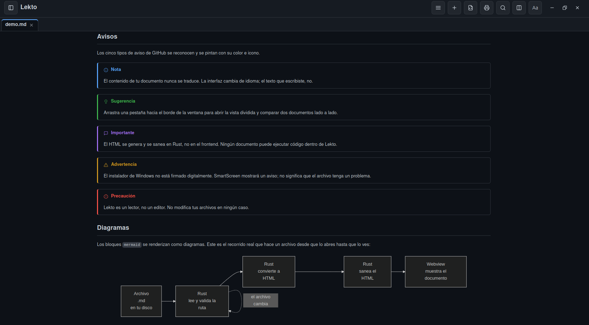

[Español](README.md)

# Lekto

A lightweight and minimalist desktop Markdown reader.


## Architecture and Performance

Unlike Electron-based readers, Lekto is built with Tauri v2 (Rust backend paired with a lightweight web frontend, with no Node.js runtime), delivering minimal resource consumption and a compact footprint:

- **Release binary:** 15.9 MiB
- **.deb package:** 5.5 MB
- **Reading and rendering a ~50 KB `.md` in Rust:** under 1 ms

## Features

- Open and render local Markdown (GFM: tables, strikethrough, task lists)
- Open files from the file manager via "Open With", or from the terminal (`lekto document.md`); if Lekto is already running, the file opens as a new tab
- HTML rendering and sanitization in Rust (not in the frontend)
- Two-pane split view
- In-document search
- Export to HTML and PDF
- Table of contents, pinned files, and recent files
- Configurable light/dark themes, zoom, and reading width
- Automatic reload when file changes on disk
- Drag and drop, and direct Markdown pasting
- English and Spanish interface (detects system language)

## What it looks like

**Reading a document.** Typography, tables and lists, with the table of contents and recent files alongside.


**Callouts and diagrams.** All five GitHub callout types, and `mermaid` blocks rendered as diagrams.



**Split view.** Two documents side by side, each pane with its own tabs.


See it for yourself: the repository ships [`docs/demo.md`](docs/demo.md), a document that gathers
everything above. Open it with Lekto.

## Requirements

Lekto uses the web engine already provided by the operating system instead of bundling its own. That is why the binary is 15.9 MiB, and also why that engine needs to be present on the system.

| System | Requires | Included by default? |
|---|---|---|
| **Linux** | `libwebkit2gtk-4.1-0` and `libgtk-3-0` | Usually yes on GNOME/GTK desktops. The packages declare them, so they install automatically with the command below |
| **Windows 10/11** | WebView2 Runtime | Yes on Windows 11 and up-to-date Windows 10. If missing, **the installer downloads and installs it automatically** (requires an internet connection during setup) |
| **macOS** | Nothing | WKWebView ships with the system |

On Ubuntu 24.04 and later the GTK package is named `libgtk-3-0t64`; it satisfies the dependency just the same, nothing special to do.

## Installation

### Linux

Download the package from the Releases section. **Use `apt`, not `dpkg`** — `apt` installs any missing libraries and `dpkg` does not:

```bash
sudo apt install ./Lekto_0.1.0_amd64.deb
```

On Fedora or openSUSE, with the `.rpm`:

```bash
sudo dnf install ./Lekto-0.1.0-1.x86_64.rpm
```

There is also an `.AppImage` that requires no installation: make it executable with `chmod +x` and run it. It is considerably larger (83 MB) because it carries its own libraries. If your system has no FUSE, run it with `./Lekto_0.1.0_amd64.AppImage --appimage-extract-and-run`.

### Windows

Download the `.exe` installer from the Releases section and run it. An `.msi` is also available for environments that prefer it.

> **SmartScreen warning:** the application is not digitally signed, so Windows will show *"Windows protected your PC"*. This does not mean there is anything wrong with the file, only that there is no paid certificate behind it. To continue: **More info → Run anyway**.

### macOS

Support is implemented but **has not been tested on a Mac yet**, so no download is available. It will be published once verified. The source code is included and can be built.

### Build from Source

Requires Rust and the Tauri v2 development dependencies. On Debian/Ubuntu:

```bash
sudo apt install libwebkit2gtk-4.1-dev libappindicator3-dev librsvg2-dev patchelf libxdo-dev build-essential file
cargo tauri build
```

## Trademark

The source code is licensed under the GPL-3.0 license. The name "Lekto" and its visual identity (icon, logo) belong to the author and are not granted with the license. Any fork or derivative redistribution must use a different name and branding.

## License

This project is licensed under the GNU General Public License v3.0 (GPL-3.0). See the `LICENSE` file for details.

Copyright (c) 2026 Francisco Acevedo Guzmán.
