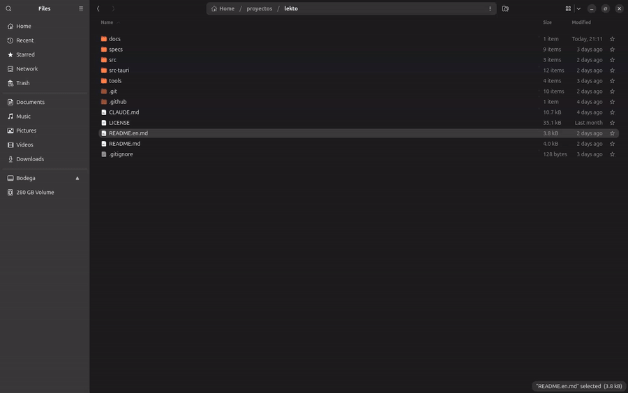
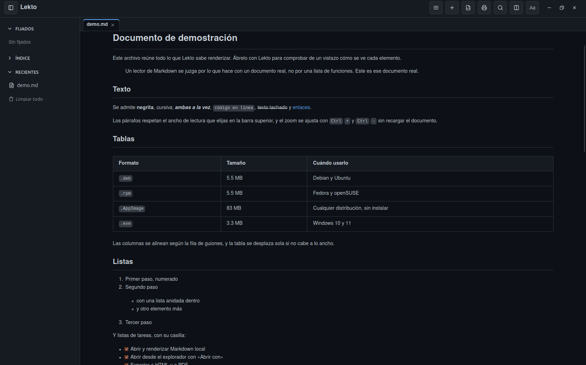
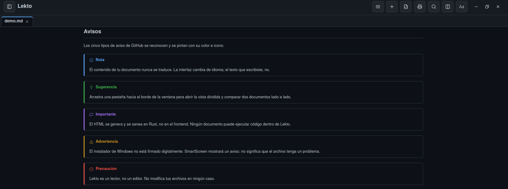
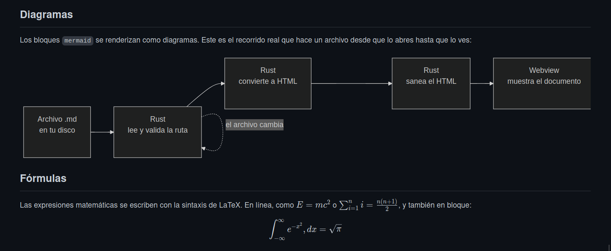
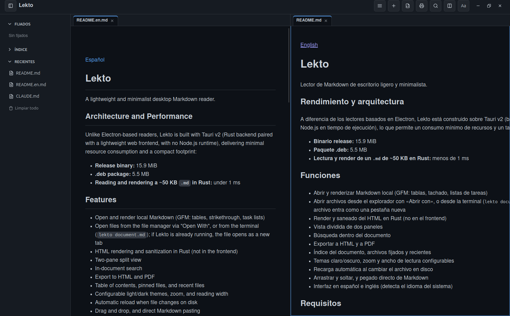

[English](README.en.md)

# Lekto

Lector de Markdown de escritorio ligero y minimalista.



## Rendimiento y arquitectura

A diferencia de los lectores basados en Electron, Lekto está construido sobre Tauri v2 (backend en Rust y frontend web sin Node.js en tiempo de ejecución), lo que permite un consumo mínimo de recursos y un tamaño reducido:

- **Binario release:** 16.0 MiB
- **Paquete .deb:** 5.5 MB
- **Lectura y render de un `.md` de ~50 KB en Rust:** menos de 1 ms

## Funciones

- Abrir y renderizar Markdown local (GFM: tablas, tachado, listas de tareas)
- Abrir archivos desde el explorador con «Abrir con», o desde la terminal (`lekto documento.md`); si Lekto ya está abierto, el archivo entra como una pestaña nueva
- Render y saneado del HTML en Rust (no en el frontend)
- Vista dividida de dos paneles
- Búsqueda dentro del documento
- Exportar a HTML y a PDF
- Índice del documento, archivos fijados y recientes
- Temas claro/oscuro, zoom y ancho de lectura configurables
- Recarga automática al cambiar el archivo en disco
- Arrastrar y soltar, y pegado directo de Markdown
- Interfaz en español e inglés (detecta el idioma del sistema)

## Así se ve

**Leyendo un documento.** Tipografía, tablas y listas, con el índice y los recientes a un lado.



**Avisos.** Los cinco tipos de aviso de GitHub, cada uno con su color y su icono.



**Diagramas y fórmulas.** Los bloques `mermaid` se renderizan como diagramas, y las expresiones matemáticas en sintaxis de LaTeX.



**Vista dividida.** Dos documentos lado a lado, cada panel con sus propias pestañas.



Puedes comprobarlo tú mismo: el repositorio incluye [`docs/demo.md`](docs/demo.md), un documento
que reúne todo lo anterior. Ábrelo con Lekto.

## Requisitos

Lekto usa el motor web que ya trae el sistema operativo en vez de incluir uno propio. Por eso el binario pesa 16.0 MiB, y también por eso necesita que ese motor esté presente en el sistema.

| Sistema | Necesita | ¿Viene por defecto? |
|---|---|---|
| **Linux** | `libwebkit2gtk-4.1-0` y `libgtk-3-0` | Normalmente sí en escritorios GNOME/GTK. Los paquetes las declaran, así que se instalan solas si usas el comando de abajo |
| **Windows 10/11** | WebView2 Runtime | Sí en Windows 11 y en Windows 10 actualizado. Si falta, **el instalador la descarga e instala solo** (requiere conexión a internet durante la instalación) |
| **macOS** | Nada | WKWebView es parte del sistema |

En Ubuntu 24.04 y posteriores el paquete de GTK se llama `libgtk-3-0t64`; satisface la dependencia igual, no hay que hacer nada especial.

## Instalación

### Linux

Descarga el paquete desde la sección de Releases. **Usa `apt` y no `dpkg`**, porque `apt` instala las bibliotecas que falten y `dpkg` no:

```bash
sudo apt install ./Lekto_0.1.2_amd64.deb
```

En Fedora u openSUSE, con el `.rpm`:

```bash
sudo dnf install ./Lekto-0.1.2-1.x86_64.rpm
```

También hay un `.AppImage` que no requiere instalar nada: dale permiso de ejecución con `chmod +x` y ábrelo. Pesa bastante más (84 MB) porque lleva sus propias bibliotecas dentro. Si tu sistema no tiene FUSE, ábrelo con `./Lekto_0.1.2_amd64.AppImage --appimage-extract-and-run`.

### Windows

Descarga el instalador `.exe` desde la sección de Releases y ejecútalo. También hay un `.msi` para entornos que lo prefieran.

> **Aviso de SmartScreen:** la aplicación no está firmada digitalmente, así que Windows mostrará *«Windows protegió su PC»*. No significa que haya un problema con el archivo, solo que no hay un certificado de pago detrás. Para continuar: **Más información → Ejecutar de todas formas**.

### macOS

El soporte está implementado pero **todavía no se ha probado en un Mac**, así que no hay descarga disponible. Se publicará cuando esté verificado. El código fuente está incluido y se puede compilar.

### Compilar desde el código

Requiere Rust y las dependencias de desarrollo de Tauri v2. En Debian/Ubuntu:

```bash
sudo apt install libwebkit2gtk-4.1-dev libappindicator3-dev librsvg2-dev patchelf libxdo-dev build-essential file
cargo tauri build
```

## Marca

El código fuente de Lekto está publicado bajo la licencia GPL-3.0. El nombre «Lekto» y su identidad visual (icono y logotipo) son propiedad del autor y no se ceden con la licencia. Cualquier bifurcación (*fork*) o redistribución derivada debe utilizar un nombre y una identidad visual propios.

## Licencia

Este proyecto está bajo la licencia GNU General Public License v3.0 (GPL-3.0). Consulta el archivo `LICENSE` para más información.

Copyright (c) 2026 Francisco Acevedo Guzmán.
