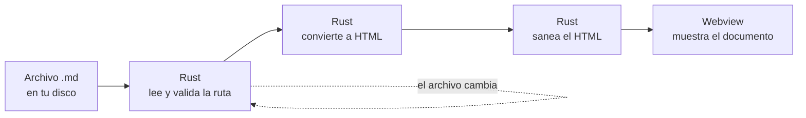

# Documento de demostración

Este archivo reúne todo lo que Lekto sabe renderizar. Ábrelo con Lekto para
comprobar de un vistazo cómo se ve cada elemento.

> Un lector de Markdown se juzga por lo que hace con un documento real, no por
> una lista de funciones. Este es ese documento real.

## Texto

Se admite **negrita**, *cursiva*, ***ambas a la vez***, `código en línea`,
~~texto tachado~~ y [enlaces](https://github.com/Panxio/lekto).

Los párrafos respetan el ancho de lectura que elijas en la barra superior, y el
zoom se ajusta con `Ctrl` `+` y `Ctrl` `-` sin recargar el documento.

## Tablas

| Formato | Tamaño | Cuándo usarlo |
|---|---:|---|
| `.deb` | 5.5 MB | Debian y Ubuntu |
| `.rpm` | 5.5 MB | Fedora y openSUSE |
| `.AppImage` | 83 MB | Cualquier distribución, sin instalar |
| `.exe` | 3.3 MB | Windows 10 y 11 |

Las columnas se alinean según la fila de guiones, y la tabla se desplaza sola
si no cabe a lo ancho.

## Listas

1. Primer paso, numerado
2. Segundo paso
   - con una lista anidada dentro
   - y otro elemento más
3. Tercer paso

Y listas de tareas, con su casilla:

- [x] Abrir y renderizar Markdown local
- [x] Abrir desde el explorador con «Abrir con»
- [x] Exportar a HTML y a PDF
- [ ] Verificar la aplicación en macOS

## Código

Cada bloque trae un botón para copiarlo, y se envuelve correctamente al
exportar a PDF.

```rust
/// Lee un archivo y devuelve su contenido, o un error tipado.
/// Nunca entra en pánico: el frontend siempre recibe un `Result`.
pub fn leer_markdown(ruta: &Path) -> Result<String, ErrorLectura> {
    if !ruta.exists() {
        return Err(ErrorLectura::NoExiste(ruta.to_path_buf()));
    }
    fs::read_to_string(ruta).map_err(ErrorLectura::Io)
}
```

```bash
# Instalar en Debian o Ubuntu (usa apt, no dpkg: apt resuelve las bibliotecas)
sudo apt install ./Lekto_0.1.1_amd64.deb

# Abrir un documento desde la terminal
lekto documento.md
```

## Avisos

Los cinco tipos de aviso de GitHub se reconocen y se pintan con su color e icono.

> [!NOTE]
> El contenido de tu documento nunca se traduce. La interfaz cambia de idioma;
> el texto que escribiste, no.

> [!TIP]
> Arrastra una pestaña hacia el borde de la ventana para abrir la vista
> dividida y comparar dos documentos lado a lado.

> [!IMPORTANT]
> El HTML se genera y se sanea en Rust, no en el frontend. Ningún documento
> puede ejecutar código dentro de Lekto.

> [!WARNING]
> El instalador de Windows no está firmado digitalmente. SmartScreen mostrará
> un aviso; no significa que el archivo tenga un problema.

> [!CAUTION]
> Lekto es un lector, no un editor. No modifica tus archivos en ningún caso.

## Diagramas

Los bloques `mermaid` se renderizan como diagramas. Este es el recorrido real
que hace un archivo desde que lo abres hasta que lo ves:



## Fórmulas

Las expresiones matemáticas se escriben con la sintaxis de LaTeX. En línea,
como $E = mc^2$ o $\sum_{i=1}^{n} i = \frac{n(n+1)}{2}$, y también en bloque:

$$
\int_{-\infty}^{\infty} e^{-x^2}\,dx = \sqrt{\pi}
$$

## Citas

> La calidad no es un acto, es un hábito.
>
> — atribuida a Aristóteles

---

Todo lo anterior se renderiza sin conexión a internet. Lekto no hace peticiones
de red en ningún momento.
